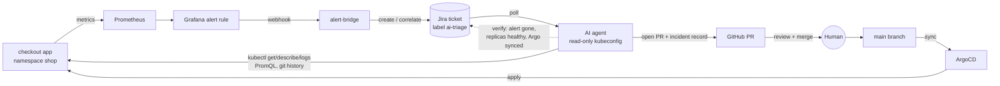

# AI SRE Agent Demo: read-only diagnosis, human-gated GitOps remediation

An AI agent gets paged by a real alert, investigates a Kubernetes cluster with a
**read-only** kubeconfig, and proposes the fix as a **pull request**. A human
reviews and merges; **ArgoCD** applies it; the agent **verifies** the incident is
resolved. Every step lands on the **Jira** ticket, so the whole incident is
auditable and MTTR is measured end to end.

The repo is a **step-by-step build**: each numbered folder adds one piece, explains the concepts,
and has a `run.sh` and a `verify.sh`. Everything runs locally on a kind cluster.



## Steps

| Step | Adds | You learn |
|---|---|---|
| [00 · Prerequisites](00-prereqs/) | tools, accounts, `demo.env`, push to GitHub | how the steps fit together |
| [01 · kind cluster](01-kind-cluster/) | single-node cluster, ports on localhost, **no CNI** | kind, NodePorts, what "NotReady" means |
| [02 · CNI: Cilium](02-cni-cilium/) | pod network, NetworkPolicy enforcement, Hubble | CNI, eBPF datapath, flow visibility |
| [03 · metrics-server](03-metrics-server/) | `kubectl top`, `metrics.k8s.io` | resource metrics API, API aggregation |
| [04 · ArgoCD](04-argocd/) | GitOps engine, 30s git polling | Applications, AppProjects, drift |
| [05 · Monitoring](05-monitoring/) | Prometheus + Grafana *(Argo app)* | multi-source Helm apps, kube-state-metrics |
| [06 · Demo app](06-demo-app/) | `checkout` + restricted AppProject *(Argo app)* | GitOps guardrails |
| [07 · Alert rules](07-alert-rules/) | 5 Grafana rules as code *(Argo app)* | alerting as code, sidecar provisioning |
| [08 · Jira integration](08-jira-integration/) | alert bridge, contact point, NetworkPolicy *(Argo app)* | webhooks, correlation, least privilege |
| [09 · Agent access](09-agent-access/) | read-only RBAC + short-lived kubeconfig *(Argo app)* | RBAC, bound tokens, proving access |
| [10 · GitHub guardrails](10-github-guardrails/) | GitHub App identity, branch protection, CI scope guard | human-gated changes |
| [11 · The agent](11-agent/) | the AI SRE agent loop | tool guards, change validation, verification |
| [12 · Failure scenarios](12-scenarios/) | 6 realistic ways to break production | the full incident loop |
| [13 · Demo runbook](13-demo/) | stage script + preflight | presenting it |

```bash
make help            # list steps and targets
make step-01         # run a step       (./01-kind-cluster/run.sh)
make verify-01       # check a step     (./01-kind-cluster/verify.sh)
make up              # steps 01-09 in one go (cluster + platform)
make down            # delete the cluster
```

## What makes it safe

| Control | Step |
|---|---|
| CNI enforces the NetworkPolicy: only Grafana can reach the Jira bridge | [02](02-cni-cilium/), [08](08-jira-integration/manifests/networkpolicy.yaml) |
| ArgoCD project for the demo app cannot create RBAC, Secrets or cluster objects | [06](06-demo-app/appproject.yaml) |
| Agent's cluster identity can only `get/list/watch`; no Secrets, exec, port-forward, impersonation | [09](09-agent-access/manifests/rbac.yaml), proven by [verify-rbac.sh](09-agent-access/verify-rbac.sh) |
| Short-lived bound ServiceAccount token (default 48h) | [09](09-agent-access/generate-agent-kubeconfig.sh) |
| Agent is a GitHub App on one repo with 1h tokens: opens PRs, never merges (branch protection + CODEOWNERS + required checks) | [10](10-github-guardrails/) |
| CI fails agent PRs that touch anything outside `06-demo-app/manifests/` or `incidents/` | [10](.github/workflows/pr-checks.yaml) |
| Agent refuses non-read kubectl verbs and Secret reads before calling the API | [11](11-agent/ai_sre_agent/kube.py) |
| Proposed files are YAML-validated, size-limited and kind-checked before a PR exists | [11](11-agent/ai_sre_agent/diagnose.py) |
| Logs, events and ticket text are treated as untrusted data (prompt-injection guard) | [11](11-agent/ai_sre_agent/prompts.py) |
| Every tool call and external write is recorded | `.agent/audit.jsonl` |

Details: [docs/SECURITY.md](docs/SECURITY.md). Problems: [docs/TROUBLESHOOTING.md](docs/TROUBLESHOOTING.md).

## Scenarios

| ID | What breaks (via a realistic git commit) | Alert | Agent outcome |
|---|---|---|---|
| `01-oomkilled` | Memory limit "rightsized" 256Mi → 64Mi | ContainerOOMKilled | PR restores limit |
| `02-bad-image-tag` | Hotfix tag that doesn't exist | ContainerImagePullFailing | PR reverts tag |
| `03-readiness-probe` | Readiness probe moved to wrong port | DeploymentRolloutStuck | PR fixes port |
| `04-configmap-key` | ConfigMap key renamed, Deployment still uses old key | ContainerConfigError | PR restores key |
| `05-cpu-request-typo` | `cpu: "50"` (50 cores) instead of 500m | PodUnschedulable | PR fixes request |
| `06-node-cordoned` | Node cordoned **outside git** | PodUnschedulable | **Escalates, no PR** |

```bash
make inject SCENARIO=01-oomkilled
make reset
```

More detail per scenario: [12-scenarios/README.md](12-scenarios/README.md).

## Repository layout

```
00-prereqs/ … 13-demo/   The steps (README.md, run.sh, verify.sh; manifests/ for ArgoCD apps)
lib/common.sh            Helpers shared by the step scripts (demo.env, context guard, wait for Argo)
incidents/               Incident records committed by agent PRs
.github/                 CODEOWNERS, PR template, CI (validate-manifests, agent-scope-guard)
docs/                    Security model, troubleshooting
tests/                   Repo-level checks (layout, manifests, scenarios vs. alert rules)
```

## Tests

All of this runs offline (no cluster or API keys needed):

```bash
pip install -r 11-agent/requirements.txt pytest
make test
```

They cover the kubectl guard, the full ticket → PR → merge → sync → verify lifecycle against
fakes, GitHub App token handling, change validation, escalation and retry paths, the alert bridge
against a fake Jira, every scenario's inject/reset round trip against a throwaway git remote, the
step layout, and manifest checks.
