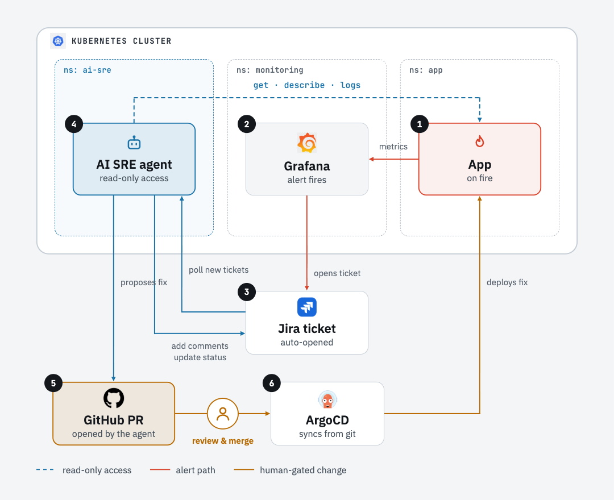

# AI SRE Agent Demo

An AI agent gets paged by a real alert, investigates Kubernetes with **read-only** access, and
proposes the fix as a **pull request**. A human merges it, **ArgoCD** deploys it, and the agent
**verifies** the fix and closes the **Jira** ticket with the MTTR. Everything runs locally on kind.



1. **App** breaks, through a realistic bad commit ([scenarios](13-scenarios/))
2. **Grafana** alert fires
3. **Jira** ticket is opened by the alert bridge
4. **Agent** picks it up, investigates (kubectl, PromQL, git history) and posts the root cause
5. **GitHub PR** with the fix, opened by the agent's GitHub App; a human reviews and merges
6. **ArgoCD** syncs it; the agent checks the alert is gone, then closes the ticket

The agent can't change the cluster itself: **read-only eyes, git-only hands.** Fixes that don't
belong in git (e.g. a cordoned node) are escalated to a human, with no PR.

## Steps

Each folder is one learning step, with a README, `run.sh` and `verify.sh`.

| Step | Adds |
|---|---|
| [00](00-prereqs/) · [01](01-kind-cluster/) · [02](02-cni-cilium/) · [03](03-metrics-server/) | prerequisites, kind cluster, Cilium CNI, metrics-server |
| [04](04-argocd/) · [05](05-monitoring/) · [06](06-demo-app/) | ArgoCD, Prometheus + Grafana, the `checkout` demo app |
| [07](07-alert-rules/) · [08](08-jira-integration/) | Grafana alert rules as code, Grafana → Jira bridge |
| [09](09-agent-access/) · [10](10-github-guardrails/) | read-only ServiceAccount + RBAC; GitHub App, branch protection, CI scope guard |
| [11](11-agent/) · [12](12-agent-operator/) | the agent's code and config; runs it in-cluster: controller + one diagnosis Job per ticket |
| [13](13-scenarios/) · [14](14-demo/) | six failure scenarios; demo runbook + preflight |

## Quick start

```bash
make up                                 # steps 01-09: cluster, platform, Jira bridge, agent RBAC
make step-10 && make step-11 && make step-12
make inject SCENARIO=01-oomkilled       # break something, then watch Jira and GitHub
make report                             # MTTR per incident, automated vs human time
make reset
```

`make help` lists every target. Run `make verify-NN` after each step.

## Scenarios

| ID | What breaks | Agent outcome |
|---|---|---|
| `01-oomkilled` | memory limit "rightsized" 256Mi → 64Mi | PR restores the limit |
| `02-bad-image-tag` | hotfix image tag that doesn't exist | PR reverts the tag |
| `03-readiness-probe` | readiness probe on the wrong port | PR fixes the port |
| `04-configmap-key` | ConfigMap key renamed, Deployment uses the old one | PR restores the key |
| `05-cpu-request-typo` | `cpu: "50"` instead of `500m` | PR fixes the request |
| `06-node-cordoned` | node cordoned outside git | **escalates, no PR** |

## Guardrails

- **Kubernetes:** the agent's ServiceAccount can only `get/list/watch`: no Secrets, exec or writes ([09](09-agent-access/manifests/rbac.yaml)). Its kubectl wrapper also refuses write verbs and Secret reads ([kube.py](11-agent/ai_sre_agent/kube.py)).
- **Split identities:** the LLM runs in a Job with no write credentials, and an admission policy pins what that Job can be. Only the controller writes to Jira and GitHub, after validating the change ([12](12-agent-operator/)).
- **Git:** the GitHub App can open PRs but never merge them. CI rejects agent PRs outside `06-demo-app/manifests/` and `incidents/` ([10](10-github-guardrails/)).
- **Prompt injection:** logs, events and ticket text are treated as untrusted data ([prompts.py](11-agent/ai_sre_agent/prompts.py)).

More: [docs/SECURITY.md](docs/SECURITY.md) · [docs/TROUBLESHOOTING.md](docs/TROUBLESHOOTING.md) ·
[docs/related-projects.html](docs/related-projects.html)

## Tests

```bash
make test        # offline: no cluster or API keys needed
```

These cover the kubectl guard, the full ticket → PR → merge → sync → verify lifecycle against fakes,
the alert bridge, every scenario's inject/reset round trip, and the manifests.
