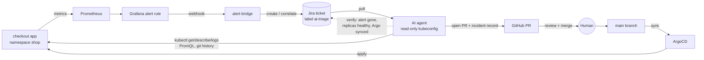

# AI SRE Agent Demo: read-only diagnosis, human-gated GitOps remediation

An AI agent gets paged by a real alert, investigates a Kubernetes cluster with a
**read-only** kubeconfig, and proposes the fix as a **pull request**. A human
reviews and merges; **ArgoCD** applies it; the agent **verifies** the incident is
resolved. Every step lands on the **Jira** ticket, so the whole incident is
auditable and MTTR is measured end to end.



## What makes it safe

| Control | Where |
|---|---|
| Agent's cluster identity can only `get/list/watch`; no Secrets, exec, port-forward, impersonation | `platform/ai-sre/rbac.yaml`, proven by `scripts/verify-rbac.sh` |
| Short-lived bound ServiceAccount token (default 48h) | `scripts/generate-agent-kubeconfig.sh` |
| Agent also refuses non-read kubectl verbs and Secret reads before calling the API | `agent/ai_sre_agent/kube.py` |
| Agent is a GitHub App on one repo: opens PRs, never merges (branch protection + CODEOWNERS + required checks); 1h tokens | `scripts/create-github-app.py`, `scripts/github-setup.sh`, `.github/` |
| CI fails agent PRs that touch anything outside `apps/` or `incidents/` | `.github/workflows/pr-checks.yaml` |
| ArgoCD project for `apps/shop` cannot create RBAC, Secrets or cluster objects | `argocd/apps/project-shop.yaml` |
| Proposed files are YAML-validated, size-limited and kind-checked before a PR exists | `agent/ai_sre_agent/diagnose.py` |
| Logs, events and ticket text are treated as untrusted data (prompt-injection guard) | `agent/ai_sre_agent/prompts.py` |
| Every tool call and external write is recorded | `.agent/audit.jsonl` |

Details: [docs/SECURITY.md](docs/SECURITY.md).

## Repository layout

```
bootstrap/root-app.yaml          ArgoCD app-of-apps (applied once)
argocd/apps/                     Applications + the restricted "shop" AppProject
apps/shop/                       The demo workload (podinfo as "checkout"). Agent PRs land here.
platform/monitoring/             kube-prometheus-stack values (Grafana alerting, no Alertmanager)
platform/monitoring-config/      Grafana alert rules, contact point, notification policy (as code)
platform/ai-sre/                 Agent RBAC + Grafana->Jira alert bridge
agent/                           The AI SRE agent (Python, Claude API) + tests
scenarios/                       Failure injection: 6 scenarios + reset
infra/kind/                      Local kind cluster + ArgoCD + metrics-server + secrets + bootstrap
scripts/                         GitHub App, kubeconfig minting, RBAC proof, Grafana token, guardrails, run-agent
incidents/                       Incident records committed by agent PRs
docs/                            Setup guide, demo runbook, security model, troubleshooting
```

## Quick start

Full walkthrough with every account and command: **[docs/SETUP.md](docs/SETUP.md)**. In short:

```bash
cp demo.env.example demo.env && $EDITOR demo.env
./scripts/configure-repo.sh && git add -A && git commit -m "configure" && git push
make github-app                                   # agent's GitHub App (one click), install on the repo
./scripts/github-setup.sh                         # branch protection + CI guard
make cluster-up                                   # kind + ArgoCD; ArgoCD deploys the rest from git
./scripts/create-grafana-token.sh                 # -> agent.env
make agent-kubeconfig verify-rbac                 # read-only kubeconfig, proven
cp agent/.env.example agent.env && $EDITOR agent.env
make agent-selftest && DRY_RUN=true make agent    # rehearse without writing anything
python3 scenarios/demo.py baseline
```

Run the show: **[docs/DEMO-RUNBOOK.md](docs/DEMO-RUNBOOK.md)**.

## Scenarios

| ID | What breaks (via a realistic git commit) | Alert | Agent outcome |
|---|---|---|---|
| `01-oomkilled` | Memory limit "rightsized" 256Mi → 64Mi | ContainerOOMKilled | PR restores limit |
| `02-bad-image-tag` | Hotfix tag that doesn't exist | ContainerImagePullFailing | PR reverts tag |
| `03-readiness-probe` | Readiness probe moved to wrong port | DeploymentRolloutStuck | PR fixes port |
| `04-configmap-key` | ConfigMap key renamed, Deployment still uses old key | ContainerConfigError | PR restores key |
| `05-cpu-request-typo` | `cpu: "50"` (50 cores) instead of 500m | PodUnschedulable | PR fixes request |
| `06-node-cordoned` | Node cordoned **outside git** | PodUnschedulable | **Escalates, no PR** |

```bash
python3 scenarios/demo.py inject 01-oomkilled
python3 scenarios/demo.py reset --uncordon
```

More detail per scenario: [scenarios/README.md](scenarios/README.md).

## Tests

All of this runs offline (no cluster or API keys needed):

```bash
pip install -r agent/requirements.txt pytest
make test
```

They cover the kubectl guard, the full ticket → PR → merge → sync → verify lifecycle against
fakes, change validation, escalation and retry paths, the alert bridge against a fake Jira,
every scenario's inject/reset round trip against a throwaway git remote, and manifest checks.
